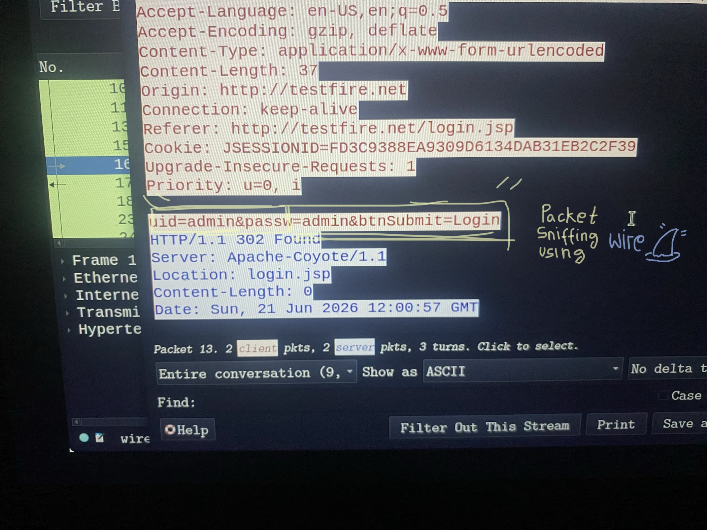

# Cybersecurity Projects & Lab Portfolio 👨🏻‍💻🚨

Welcome to my practical cybersecurity portfolio. This repository documents my hands-on labs, network traffic investigations, and security reports and much more along my way as I continue to hack the unhackable with my virtual machine labs.

Coming from a **Clinical Psychology** background, I approach cybersecurity with an investigative mindset—focusing on how attackers exploit human behavior and technical vulnerabilities, and how organizations can document and fix risks clearly.

 
## Project 1: Packet Sniffing & HTTP Credential Capture
* Tool Used: Wireshark
* Objective: captured and analyzed live network traffic to identify unencrypted login requests over HTTP.
* Key Findings: Intercepted plaintext credentials ('uid=adminpassw=admin') on a test login page ('testfire.net') demonstrating why HTTPS encryption is critical for protecting user data.

